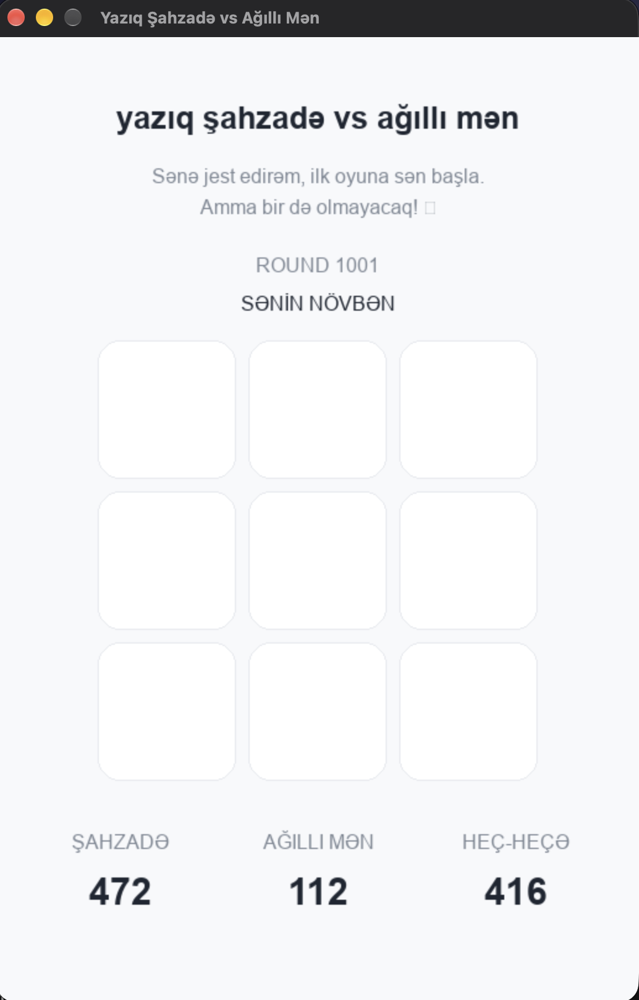
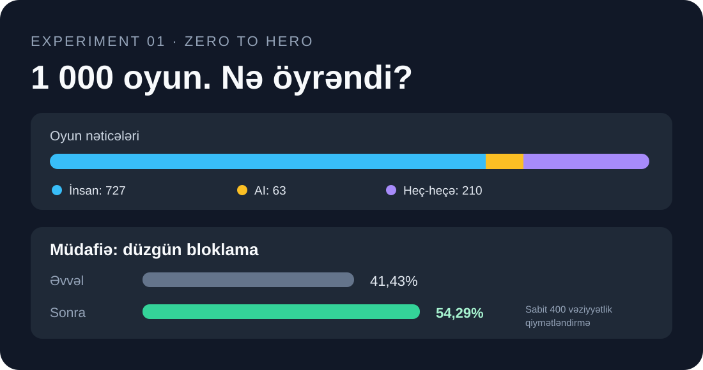

<div align="center">

# Human vs AI 🎮

### 1 000 oyun. Sıfırdan başlayan AI nə öyrəndi?

Öncədən yazılmış qalibiyyət strategiyası yoxdur. Sadəcə **XOX qaydaları**, **Q-learning** və insana qarşı 1 000 real oyun.

[](https://github.com/mstfyvshzde/human-vs-ai-tic-tac-toe/actions/workflows/tests.yml)

**[Oyunu qur](#-oyunu-sına)** · **[Nəticələrə bax](#-experiment-1--nəticələr)** · **[Ətraflı hesabat](experiments/zero_to_hero_2/README.md)** · **[English](README.en.md)**

</div>

---

## 🕹️ Oyundan görüntü

<div align="center">
  
</div>

## 📊 Experiment 1 — Nəticələr



| Göstərici | Başlanğıc | 1 000 oyundan sonra |
|:--|--:|--:|
| Optimal gedişlər (sabit test) | 63,25% | **63,50%** |
| Düzgün bloklama (sabit test) | 41,43% | **54,29%** |

**Nə öyrəndi?** Bəzi təhlükəli gedişləri bloklamağı və müəyyən açılışlara cavab verməyi.

**Nədə çətinlik çəkdi?** Taxta döndürüldükdə eyni strategiyanı etibarlı şəkildə tətbiq etməyi. Son 40 oyunda sol alt künc açılışına qarşı **24 fürsətdən yalnız 3-də** mərkəzi seçdi.

> **Nəticə:** Müdafiədə irəliləyiş var, amma ümumi optimal strategiyanın öyrənildiyini söyləmək olmaz. Oyunlar zamanı insanın oynama tərzi də dəyişib; sabit test buna görə xüsusilə vacibdir.

[**Eksperimentin metodologiyası, məhdudiyyətləri və tam nəticələri →**](experiments/zero_to_hero_2/README.md)

## 🚀 Oyunu sına

Python 3.10+ tələb olunur. macOS üçün:

```bash
git clone https://github.com/mstfyvshzde/human-vs-ai-tic-tac-toe.git
cd human-vs-ai-tic-tac-toe
python3 -m venv .venv
source .venv/bin/activate
pip install -r requirements.txt
python main.py
```

Windows və əlavə təlimatlar: **[INSTALL.md](INSTALL.md)**.

## 🧠 Necə işləyir?

- **Oyun:** Python + Pygame, insan **S**, AI **A** olaraq oynayır.
- **Öyrənmə:** Tabular Q-learning; `α = 0.1`, `γ = 0.95`, `ε = 0.15`.
- **Qaydalar:** AI gedişləri seçir; qalibiyyət və müdafiə strategiyası öncədən kodlaşdırılmayıb.
- **Qiymətləndirmə:** Hər 100 oyundan bir checkpoint və eyni 400 taxta vəziyyətində analiz. Minimax burada **qiymətləndirmə üçündür**, AI-yə gediş öyrətmir.
- **Məlumatlar:** Xam oyun qeydləri və öyrədilmiş model lokal saxlanılır, bu repoda yayımlanmır.

## 🔭 Növbəti: Experiment 2

**Bir küncdə öyrəndiyini digər küncdə niyə unudur?** Növbəti eksperimentdə simmetriyanı nəzərə alan Q-learning yanaşmasını müqayisə edəcəyik.

---

<sub>İdeya, eksperiment dizaynı və testlər: Şahzadə Mustafayev. Kodun hazırlanmasında ChatGPT-dən müəllifin yönləndirməsi ilə istifadə olunub. [MIT License](LICENSE) · [English README](README.en.md)</sub>
